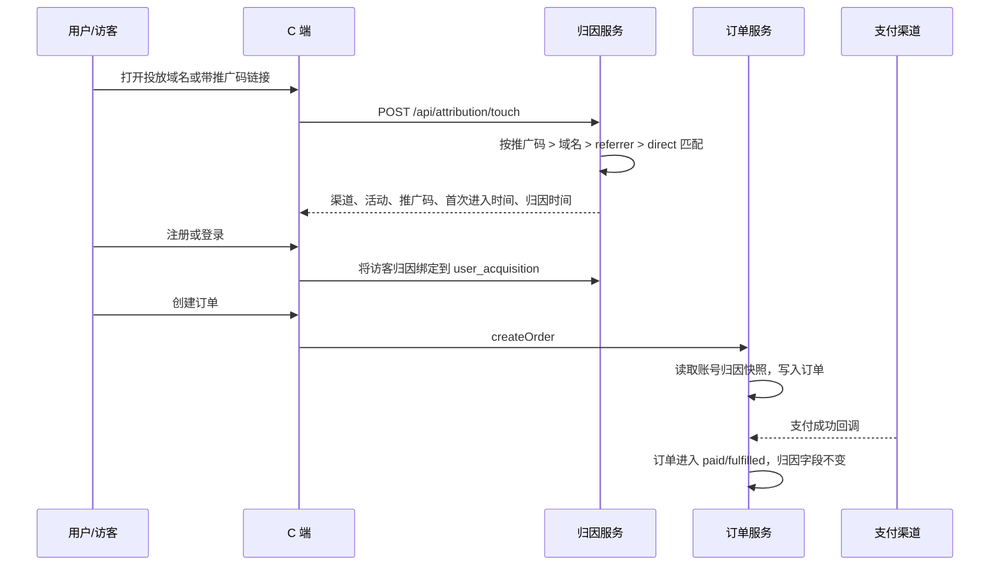
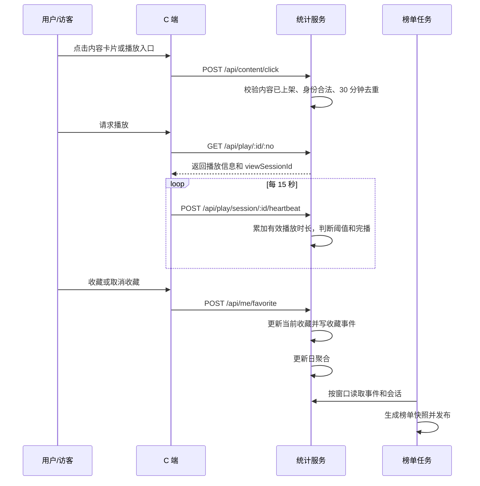
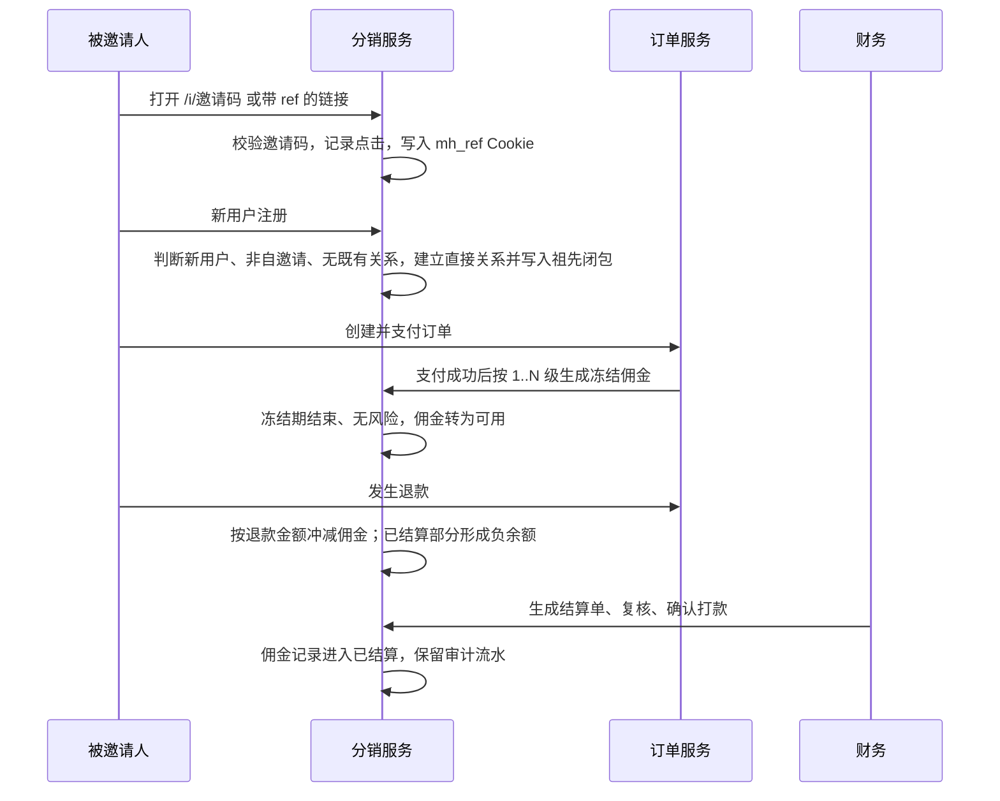

# 影巢：渠道归因、内容数据统计与分销裂变需求方案（初稿）

| 项目 | 内容 |
|---|---|
| 文档状态 | 初稿，待产品、技术、财务、法务评审 |
| 适用系统 | 影巢 C 端、运营后台；Node.js 22.5+，SQLite WAL |
| 文档日期 | 2026-11-11 |
| 关联模块 | 访客与登录、订单支付、内容播放、榜单、后台 RBAC |
| 不在本期范围 | 外部广告平台自动回传、第三方归因平台、个性化推荐模型、超过站点配置上限的更高层级分销、自动打款 |

本方案把投放渠道、内容统计和分销裂变拆成三条独立数据链路：渠道归因解释订单从哪里来，内容统计解释什么内容在被看，分销只解释邀请关系和佣金。三条链路可以共用一个访客标识，但不能互相覆盖原始事实。

## 三部分导航

| 需求部分 | 数据字段 | 统计口径 | 功能流程 | 验收标准 | 接口 |
|---|---|---|---|---|---|
| 1. 渠道归因与订单记录 | 1.6.1 | 1.7.1 | 1.4.1 | 1.8.1 | 2.1.1 |
| 2. 内容互动数据统计 | 1.6.2 | 1.7.2、1.7.3 | 1.4.2 | 1.8.2 | 2.1.2 |
| 3. 分销裂变 | 1.6.3 | 1.7.4 | 1.4.3 | 1.8.3 | 2.1.3 |

三部分共用同一套订单、内容、用户和访客基础数据，但各自保留独立事实表。渠道归因不把支付渠道 `orders.channel` 当投放渠道；内容统计不把播放请求直接当有效观看；分销只记录邀请关系和佣金，不覆盖投放归因。

C 端对外名称统一使用“佣金推广”，入口为 `#/promotion`；后台运营和数据域内部仍使用“分销”，接口路径和表名保留 `distribution`，避免数据模型与运营口径混用。

首版建议采用以下默认值。它们全部做成配置项，不写死在代码里；上线前由运营、财务确认。

| 配置项 | 建议初始值 | 说明 |
|---|---:|---|
| 渠道归因窗口 | 30 天 | 匿名访客首次有效渠道触达到注册的时间窗口 |
| 默认归因模型 | 首次归因 | 首次有效非直接渠道触达后固定到账号；末次触达单独留存供分析 |
| 点击去重窗口 | 30 分钟 | 同一身份、内容、入口、来源模块在窗口内只计一次 |
| 有效观看阈值 | `min(120s, max(30s, 10% × 时长))` | 剧集、电影、漫剧统一公式，按时长自适应 |
| 同集观看去重窗口 | 24 小时 | 同一身份在同一集 24 小时内最多计一次有效观看 |
| 榜单最小样本 | 20 名有效观众 | 完播榜、推荐榜使用，避免 1 人观看就上榜 |
| 佣金冻结期 | 7 天 | 支付成功后的可退款观察期 |
| 最低结算金额 | 100 元 | 低于门槛顺延到下一结算周期 |
| 分销层级 | 默认 3 级，最大 5 级 | 直接邀请为 1 级；默认开启 1–3 级，级数、每级比例和总比例上限按站点配置 |

## 1. 需求理解

### 1.1 需求背景

当前系统已经具备匿名访客标识、播放埋点、行为埋点、收藏、订单支付和后台 RBAC，但这些数据还没有形成三条可核对的数据链路：

- `orders.channel` 记录的是支付宝、USDT、mock 等支付渠道，不是投放渠道。订单目前无法回答“这笔钱来自哪个域名、哪个推广码、哪个投流渠道”。
- `visitors` 只保留首次访问路径，没有渠道、推广码、域名来源和归因时间；匿名访客登录后也没有账号级归因快照。
- `play_events` 记录播放请求，`track_events` 记录曝光、详情、收藏等行为。播放请求不等于有效观看，收藏行为也没有增减流水，无法稳定计算排行榜。
- `favorites` 直接插入和删除，没有收藏事件历史；取消收藏后无法还原“何时加、何时取消”。
- 系统没有分销关系、邀请码、佣金规则、结算单和退款回溯，无法支持用户裂变。

### 1.2 需求目标

1. 所有新订单在创建时写入不可被前端覆盖的渠道归因快照，支付完成后仍可追溯。
2. 可按渠道、活动、域名、推广码查询访问、注册、下单、支付和退款，支撑投流方向判断。
3. 对剧集、电影、漫剧统一统计点击、有效观看、收藏，并可按时段、内容类型、分类、渠道查询。
4. 自动生成可复现的热播、收藏、完播、新片和推荐榜单，榜单结果可审计。
5. 建立可配置的多级分销关系、逐级佣金记录、退款回溯和结算流程，能够定位每笔佣金来自哪个上级、哪笔订单和哪条规则。
6. 对刷单、自邀请、重复绑定、异常退款和重复结算设置基础拦截和风险冻结。

### 1.3 关键术语与口径

| 术语 | 定义 |
|---|---|
| 投放渠道 | 广告、达人、联盟、分销、自然流量等获客来源。新字段统一使用 `acquisition_` 前缀，避免与 `orders.channel` 混淆。 |
| 支付渠道 | 现有的支付宝、USDT、mock，对应 `orders.channel`，本方案不改语义。 |
| 访客 | 未登录或未绑定账号的浏览器身份，使用 `visitor_id`。 |
| 用户 | 已登录账号，使用 `user_id`。 |
| 统计身份 | 登录后使用 `u:{user_id}`，未登录使用 `v:{visitor_id}`。同一访客登录后，登录前的匿名观看不追溯合并，避免共享设备误并。 |
| 首次归因 | 用户在归因窗口内第一次被有效非直接渠道触达，渠道固定到账号。直接访问不会覆盖已有渠道。 |
| 末次归因 | 用户在归因窗口内最后一次有效非直接渠道触达，保留在触达流水中，供分析使用。首版订单快照默认取首次归因。 |
| 首次进入时间 | `first_enter_at`，本次归因链路中第一次有效进入平台的时间，不等同于访客历史上第一次访问时间。 |
| 归因时间 | `attributed_at`，归因被确定并写入访客或账号快照的时间。匿名归因在首次有效触达时确定，账号归因在注册/首次登录绑定时确定。 |
| 有效观看 | 满足最小有效播放时长、页面可见、播放器持续播放的观看会话。具体公式见 1.7.2。 |
| 内容类型 | 新增 `series`（剧集）、`movie`（电影）、`comic_drama`（漫剧）。现有 `dramas.category` 继续作为展示分类，不直接替代统计类型。 |
| 分销关系 | 用户与直接邀请人的绑定关系，以及由直接关系推导出的祖先闭包。直接邀请为 1 级，邀请人的邀请人为 2 级，依次向上；默认启用 3 级，最大 5 级可配。 |
| 团队关系 | 以某个分销员为祖先的所有下级集合。团队人数和团队业绩来自闭包表，团队 GMV 不能被多个上级相加后当作全站 GMV。 |
| 佣金基数 | 订单实际支付金额扣除已退款金额后的金额，以分为单位计算。优惠券已经体现在订单支付金额中。 |

### 1.4 总体业务流程

#### 1.4.1 渠道归因与订单



关键分支：

- 用户先访问直接域名，再访问投放域名：首次有效非直接触达生效，订单归因到投放渠道。
- 用户先访问投放渠道，再直接访问：直接访问不覆盖投放渠道。
- 推广码有效且域名也命中：推广码优先，域名仍记录在 `domain_source`。
- 推广码无效或已过期：不参与渠道选择，记录拒绝原因；继续尝试域名映射。
- 用户已经注册且已有账号归因：后续广告触达不覆盖首次归因；末次触达只写入触达流水。
- 上线前已经存在的用户：标记为 `legacy_unattributed`，不把历史用户重新算成新客；其新订单单独展示。
- 归因写入失败：订单可以继续创建，但必须记录 `attribution_status='missing'`，进入后台异常列表；禁止静默写成直接渠道。

#### 1.4.2 内容互动统计



关键分支：

- 未登录用户可以产生点击和匿名观看；收藏必须登录，登录前的收藏操作由前端引导登录后重放。
- 播放接口未通过权益校验时不创建观看会话，不产生有效观看。
- 心跳超过 45 秒未上报，会话过期；已累计有效时长仍可结算，但不再增长。
- 页面切后台、暂停、拖动进度条跳过的时间不计入有效时长。
- 统计写入失败不得阻断播放；失败事件进入重试队列，超过重试上限写入告警日志。

#### 1.4.3 分销裂变



关键分支：

- 邀请码有效但注册人已有账号：只记录点击，不建立关系。
- 邀请人是自己：拒绝绑定，记录风险事件。
- 同一被邀请人已经绑定过邀请人：拒绝再次绑定，已有关系不变。
- 邀请码过期、停用或超过使用上限：不建立关系。
- 级数超过站点配置：不生成超过上限的佣金；直接关系仍保留，但 4 级及以上的佣金记录不创建。
- 支付回调重复：佣金记录以 `(order_id, distributor_user_id)` 唯一约束幂等，不重复生成。
- 退款发生在冻结期内：直接冲减未结算佣金；退款发生在已结算后：形成负余额，下一次结算抵扣，必要时人工追偿。
- 结算单复核人与创建人不能是同一人，与现有退款双人复核规则保持一致。

### 1.5 状态设计

| 对象 | 状态 | 说明 |
|---|---|---|
| 渠道 | `active`、`disabled` | 停用后不再接受新归因，历史订单不变 |
| 推广码 | `active`、`disabled`、`expired` | 过期由有效时间计算，不依赖定时改状态 |
| 访客归因 | `unattributed`、`attributed`、`legacy_unattributed` | 直接访问也写入 `direct` 渠道，但不等同于未归因 |
| 观看会话 | `active`、`ended`、`expired`、`invalid` | `valid` 是独立布尔字段，不靠状态推断 |
| 分销关系 | `active`、`frozen`、`invalid` | 风险审核期间冻结该关系对应订单的佣金；`blocked` 节点同时暂停其上级在该子树上的佣金 |
| 佣金 | `frozen`、`available`、`settling`、`paid`、`reversed`、`canceled` | 退款、结算和风险审核都写佣金事件 |
| 结算单 | `pending_review`、`approved`、`paying`、`paid`、`rejected` | 创建人与复核人分离 |
| 榜单任务 | `running`、`success`、`failed` | 失败不覆盖上一版已发布榜单 |

### 1.6 数据库设计

数据库沿用现有 SQLite WAL。新增表使用 `INTEGER` 主键、`TEXT` 时间、`INTEGER` 计数和 `INTEGER` 金额分；时间统一存 UTC，报表按 `Asia/Shanghai` 切日。新表字段名使用 snake_case，SQLite 没有原生 `DECIMAL`，佣金金额不使用浮点数。

本轮涉及四类变更：

- 新增渠道、内容统计、分销相关表。
- 扩展 `visitors`、`orders`、`dramas`、`users` 的字段。
- 增加查询索引和唯一约束。
- 回填历史数据的兼容字段，不伪造历史观看行为。

#### 1.6.1 渠道归因与订单字段

**渠道基础表**

| 表 | 字段 | 类型 | 可空 | 说明 |
|---|---|---|---|---|
| `channels` | `id` | INTEGER PK | 否 | 渠道 ID |
| | `channel_code` | TEXT UNIQUE | 否 | 稳定编码，如 `douyin_a` |
| | `channel_name` | TEXT | 否 | 后台显示名称 |
| | `channel_type` | TEXT | 否 | `paid_ad`、`kol`、`affiliate`、`distribution`、`organic`、`direct`、`legacy_unattributed` |
| | `status` | TEXT | 否 | `active`、`disabled`，默认 `active` |
| | `owner_name` | TEXT | 是 | 责任人或投放负责人 |
| | `valid_from`、`valid_to` | TEXT | 是 | 渠道生效区间 |
| | `created_at`、`updated_at` | TEXT | 否 | UTC 时间 |
| `channel_campaigns` | `id` | INTEGER PK | 否 | 活动 ID |
| | `channel_id` | INTEGER FK | 否 | 所属渠道 |
| | `campaign_code` | TEXT | 否 | 活动编码 |
| | `campaign_name` | TEXT | 否 | 活动名称 |
| | `external_campaign_id` | TEXT | 是 | 外部平台活动 ID |
| | `status` | TEXT | 否 | `active`、`disabled` |
| | `start_at`、`end_at` | TEXT | 是 | 活动时间 |
| | `created_at`、`updated_at` | TEXT | 否 | UTC 时间 |
| | 唯一约束 | | | `UNIQUE(channel_id, campaign_code)` |
| `channel_domains` | `id` | INTEGER PK | 否 | 域名映射 ID |
| | `channel_id` | INTEGER FK | 否 | 所属渠道 |
| | `campaign_id` | INTEGER FK | 是 | 可绑定到具体活动 |
| | `host` | TEXT | 否 | 标准化 Host，不含协议和端口 |
| | `path_prefix` | TEXT | 否 | 路径前缀，默认 `/`，最长前缀优先 |
| | `status` | TEXT | 否 | `active`、`disabled` |
| | `valid_from`、`valid_to` | TEXT | 是 | 生效区间 |
| | 唯一约束 | | | `UNIQUE(host, path_prefix)` |
| `promo_codes` | `id` | INTEGER PK | 否 | 推广码 ID |
| | `code` | TEXT UNIQUE | 否 | 推广码，大小写不敏感存储为统一大写 |
| | `channel_id` | INTEGER FK | 否 | 所属渠道 |
| | `campaign_id` | INTEGER FK | 是 | 所属活动 |
| | `purpose` | TEXT | 否 | `acquisition` 或 `distribution` |
| | `distributor_user_id` | INTEGER FK | 是 | 分销码对应的分销员 |
| | `status` | TEXT | 否 | `active`、`disabled` |
| | `valid_from`、`valid_to` | TEXT | 是 | 生效区间 |
| | `max_uses`、`used_count` | INTEGER | 否 | 0 表示不限 |
| | `created_at`、`updated_at` | TEXT | 否 | UTC 时间 |

**触达与归因快照**

| 表 | 字段 | 类型 | 可空 | 说明 |
|---|---|---|---|---|
| `channel_touches` | `id` | INTEGER PK | 否 | 触达 ID |
| | `visitor_id` | TEXT | 是 | 匿名访客 ID |
| | `user_id` | INTEGER FK | 是 | 已登录用户 ID |
| | `channel_id` | INTEGER FK | 否 | 命中渠道 |
| | `campaign_id` | INTEGER FK | 是 | 命中活动 |
| | `promo_code` | TEXT | 是 | 命中推广码 |
| | `channel_type` | TEXT | 否 | 触达时快照 |
| | `domain_source` | TEXT | 是 | 访问域名，规范化后的 Host |
| | `landing_url` | TEXT | 是 | 落地页 URL，去掉敏感参数后保存 |
| | `referrer_url` | TEXT | 是 | 来源页，按数据最小化规则截断 |
| | `utm_source`、`utm_medium`、`utm_campaign`、`utm_content`、`utm_term` | TEXT | 是 | 广告参数 |
| | `match_rule` | TEXT | 否 | `promo_code`、`domain`、`referrer`、`direct` |
| | `is_valid` | INTEGER | 否 | 1 有效，0 被拒绝 |
| | `reject_reason` | TEXT | 是 | 无效推广码、渠道停用等 |
| | `occurred_at` | TEXT | 否 | 实际进入时间 |
| | `created_at` | TEXT | 否 | 入库时间 |
| `visitors` 扩展 | `first_channel_id` | INTEGER FK | 是 | 首次有效渠道 |
| | `first_campaign_id` | INTEGER FK | 是 | 首次有效活动 |
| | `first_promo_code` | TEXT | 是 | 首次有效推广码 |
| | `first_domain_source` | TEXT | 是 | 首次进入域名 |
| | `first_enter_at` | TEXT | 是 | 归因链路的首次进入时间 |
| | `attributed_at` | TEXT | 是 | 归因确定时间 |
| | `attribution_model` | TEXT | 是 | `first_touch`、`last_touch`、`legacy_unattributed` |
| | `first_channel_touch_id` | INTEGER FK | 是 | 首次触达记录 |
| | `last_channel_id` | INTEGER FK | 是 | 末次有效渠道 |
| | `last_touch_at` | TEXT | 是 | 末次有效触达时间 |
| `user_acquisitions` | `user_id` | INTEGER PK/FK | 否 | 用户 ID，一人一条 |
| | `first_channel_id` | INTEGER FK | 否 | 首次归因渠道 |
| | `first_campaign_id` | INTEGER FK | 是 | 首次活动 |
| | `first_promo_code` | TEXT | 是 | 首次推广码 |
| | `first_domain_source` | TEXT | 是 | 首次域名 |
| | `first_enter_at` | TEXT | 否 | 首次进入时间 |
| | `attributed_at` | TEXT | 否 | 账号归因时间 |
| | `attribution_model` | TEXT | 否 | 默认 `first_touch` |
| | `attribution_touch_id` | INTEGER FK | 是 | 归因依据触达 |
| | `last_channel_id` | INTEGER FK | 是 | 末次渠道，供分析 |
| | `last_touch_at` | TEXT | 是 | 末次触达时间 |
| | `created_at`、`updated_at` | TEXT | 否 | UTC 时间 |

**订单扩展字段**

`orders` 的现有 `channel` 字段继续表示支付渠道。投放渠道统一新增以下字段，避免改语义造成支付代码和历史查询破坏。

| 字段 | 类型 | 可空 | 说明 |
|---|---|---|---|
| `acquisition_channel_id` | INTEGER FK | 是 | 订单归因投放渠道 |
| `acquisition_channel_type` | TEXT | 是 | 订单创建时的渠道类型快照 |
| `acquisition_campaign_id` | INTEGER FK | 是 | 活动 ID |
| `promo_code` | TEXT | 是 | 推广码快照 |
| `domain_source` | TEXT | 是 | 域名来源快照 |
| `first_enter_at` | TEXT | 是 | 首次进入时间快照 |
| `attributed_at` | TEXT | 是 | 归因时间快照 |
| `attribution_model` | TEXT | 是 | 首版 `first_touch`，历史数据 `legacy_unattributed` |
| `attribution_touch_id` | INTEGER FK | 是 | 归因依据的触达记录 |
| `attribution_snapshot_json` | TEXT | 是 | 落地页、referrer、UTM、匹配规则的只读快照 |
| `distributor_user_id` | INTEGER FK | 是 | 分销员用户 ID，独立于投放渠道 |
| `distribution_code` | TEXT | 是 | 分销邀请码快照 |
| `distribution_relation_id` | INTEGER FK | 是 | 分销关系 ID |
| `commission_base_fen` | INTEGER | 是 | 佣金基数，分 |
| `commission_total_fen` | INTEGER | 是 | 该订单所有层级佣金合计，分 |
| `commission_record_count` | INTEGER | 是 | 该订单生成的佣金记录数 |
| `commission_rule_snapshot_json` | TEXT | 是 | 订单支付时各层级规则、比例和上限的快照 |

新订单的归因字段由服务端从 `user_acquisitions` 或 `visitors` 读取，前端不得传入 `acquisition_channel_id`、`promo_code` 等字段覆盖。历史订单在迁移时统一绑定系统渠道 `legacy_unattributed`，不参与渠道转化率分子分母，只进入总额对账。

**索引**

- `channel_touches(visitor_id, occurred_at)`
- `channel_touches(channel_id, occurred_at)`
- `channel_touches(campaign_id, occurred_at)`
- `channel_touches(promo_code, occurred_at)`
- `channel_domains(host, path_prefix, status)`
- `promo_codes(code, purpose, status)`
- `orders(acquisition_channel_id, created_at)`
- `orders(acquisition_channel_id, paid_at)`
- `orders(distributor_user_id, created_at)`
- `orders(attribution_status, created_at)`

**存储与查询方式**

- 触达流水只增不改，订单只保存创建时的归因快照。支付回调、退款和后台编辑都不改 `orders` 的归因字段。
- 查询订单转化时，下单量按 `orders.created_at` 归属日期，支付金额按 `orders.paid_at` 归属日期，退款金额按退款完成时间归属日期。三类口径必须分列展示，不能混成一个“收入”数字。
- 投流分析以订单快照为主，触达流水只用于计算访客和触达，不用触达流水反推订单。
- 首轮查询直接使用订单表索引；数据量增长后再增加按日渠道汇总表，不改变订单事实。

示例：按渠道统计下单、支付和退款。

```sql
SELECT
  o.acquisition_channel_id AS channel_id,
  COUNT(*) AS created_orders,
  SUM(CASE WHEN o.status IN ('paid', 'fulfilled') THEN 1 ELSE 0 END) AS paid_orders,
  SUM(CASE WHEN o.status IN ('paid', 'fulfilled') THEN o.amount_cny ELSE 0 END) AS gross_paid_amount,
  SUM(CASE WHEN o.status = 'refunded' THEN o.refunded_amount ELSE 0 END) AS refund_amount,
  SUM(CASE WHEN o.status IN ('paid', 'fulfilled') THEN o.amount_cny ELSE 0 END)
    - SUM(CASE WHEN o.status = 'refunded' THEN o.refunded_amount ELSE 0 END) AS net_revenue
FROM orders o
WHERE o.created_at >= ?
  AND o.created_at < ?
  AND o.acquisition_channel_id IS NOT NULL
GROUP BY o.acquisition_channel_id;
```

#### 1.6.2 内容互动统计字段

**内容主表扩展**

| 表 | 字段 | 类型 | 说明 |
|---|---|---|---|
| `dramas` | `content_type` | TEXT | `series`、`movie`、`comic_drama` |
| | `published_at` | TEXT | 实际上架时间；为空时不能进入新片榜 |

`content_type` 不复用自由文本 `category`。迁移时按下表处理，无法确定的记录不自动猜测，进入后台待归类列表：

| 现有分类 | 处理 |
|---|---|
| `MOVIE` | `movie` |
| `TV` | `series` |
| `PLAYLET` | 先标 `series`；有“漫剧”标签或人工确认后改 `comic_drama` |
| `ANIME` | 不自动判定，后台人工选择 `series` 或 `comic_drama` |

**事件表**

| 表 | 字段 | 类型 | 说明 |
|---|---|---|---|
| `content_click_events` | `id` | INTEGER PK | 点击记录 |
| | `dedup_key` | TEXT UNIQUE | `viewer_key + content_id + entry_page + source_module + 30 分钟桶` 的哈希 |
| | `viewer_key` | TEXT | `u:{user_id}` 或 `v:{visitor_id}` |
| | `user_id`、`visitor_id` | INTEGER/TEXT | 原始身份 |
| | `content_id` | INTEGER FK | 内容 ID |
| | `episode_id` | INTEGER FK | 可空，选集点击时填写 |
| | `entry_page` | TEXT | 首页、分类、榜单、搜索、详情、推荐等 |
| | `source_module` | TEXT | 具体模块，如 `hero`、`poster_grid`、`rank` |
| | `position` | INTEGER | 模块内位置 |
| | `occurred_at` | TEXT | 点击时间 |
| | `client_ts` | TEXT | 客户端时间，仅辅助排查 |
| | `ip_hash`、`ua_hash` | TEXT | 反作弊辅助，使用哈希 |
| | `created_at` | TEXT | 入库时间 |
| `content_view_sessions` | `id` | TEXT PK | 服务端生成的会话 ID |
| | `viewer_key` | TEXT | 统计身份 |
| | `user_id`、`visitor_id` | INTEGER/TEXT | 原始身份 |
| | `content_id` | INTEGER FK | 内容 ID |
| | `episode_id` | INTEGER FK | 分集 ID |
| | `content_type` | TEXT | 会话时快照 |
| | `source` | TEXT | `free`、`subscription`、`purchase`、`trial`、`preview` |
| | `started_at` | TEXT | 会话开始 |
| | `last_heartbeat_at` | TEXT | 最后心跳 |
| | `ended_at` | TEXT | 结束时间 |
| | `duration_seconds` | REAL | 内容总时长 |
| | `effective_seconds` | REAL | 有效播放秒数 |
| | `max_position_seconds` | REAL | 最大播放进度 |
| | `playback_rate` | REAL | 最近一次播放倍速 |
| | `status` | TEXT | `active`、`ended`、`expired`、`invalid` |
| | `is_valid` | INTEGER | 是否达到有效观看阈值 |
| | `completed` | INTEGER | 是否达到 90% 进度 |
| | `valid_at` | TEXT | 首次变为有效的时刻 |
| | `created_at` | TEXT | 入库时间 |
| `content_favorite_events` | `id` | INTEGER PK | 收藏事件 |
| | `dedup_key` | TEXT UNIQUE | 请求幂等键 |
| | `user_id` | INTEGER FK | 收藏用户 |
| | `content_id` | INTEGER FK | 内容 ID |
| | `action` | TEXT | `add`、`remove` |
| | `from_state`、`to_state` | INTEGER | 变更前后状态 |
| | `is_migration` | INTEGER | 历史迁移标记，不进入期间新增统计 |
| | `occurred_at` | TEXT | 操作时间 |
| | `created_at` | TEXT | 入库时间 |

**聚合表**

| 表 | 字段 | 类型 | 说明 |
|---|---|---|---|
| `content_stats_daily` | `stat_date` | TEXT | 上海时区自然日 `YYYY-MM-DD` |
| | `content_id` | INTEGER FK | 内容 ID |
| | `content_type` | TEXT | 会话时快照 |
| | `click_count` | INTEGER | 去重后点击 |
| | `click_uv` | INTEGER | 当日点击人数 |
| | `play_request_count` | INTEGER | 播放请求数，兼容历史 |
| | `view_count` | INTEGER | 有效观看次数 |
| | `viewer_count` | INTEGER | 当日有效观看人数 |
| | `completion_count` | INTEGER | 完播次数 |
| | `completion_rate` | REAL | 完播次数 / 有效观看次数 |
| | `favorite_add_count` | INTEGER | 新增收藏次数 |
| | `favorite_remove_count` | INTEGER | 取消收藏次数 |
| | `favorite_add_uv` | INTEGER | 当日新增收藏人数 |
| | `avg_watch_seconds` | REAL | 有效观看平均时长 |
| | `updated_at` | TEXT | 聚合更新时间 |
| | 主键 | | `(stat_date, content_id)` |
| `content_stats_total` | `content_id` | INTEGER PK/FK | 内容 ID |
| | `lifetime_click_count` | INTEGER | 生命周期去重点击 |
| | `lifetime_view_count` | INTEGER | 生命周期有效观看 |
| | `lifetime_viewer_count` | INTEGER | 生命周期去重观看人数 |
| | `current_favorite_count` | INTEGER | 当前有效收藏数 |
| | `updated_at` | TEXT | 更新时间 |
| `content_rank_runs` | `id` | INTEGER PK | 榜单计算批次 |
| | `rank_type` | TEXT | `hot`、`favorite`、`completion`、`new`、`recommend` |
| | `dimension_type` | TEXT | `all`、`content_type`、`category` |
| | `dimension_value` | TEXT | 维度值 |
| | `window_start`、`window_end` | TEXT | 统计窗口 |
| | `strategy_version` | TEXT | 规则版本 |
| | `status` | TEXT | `running`、`success`、`failed` |
| | `generated_at` | TEXT | 生成时间 |
| | `error_message` | TEXT | 失败原因 |
| `content_rank_snapshots` | `run_id` | INTEGER FK | 计算批次 |
| | `content_id` | INTEGER FK | 内容 ID |
| | `rank_no` | INTEGER | 名次 |
| | `score` | REAL | 排序分或主排序值 |
| | `metrics_json` | TEXT | 生成时的指标快照 |
| | `generated_at` | TEXT | 生成时间 |
| | 唯一约束 | | `UNIQUE(run_id, content_id)`、`UNIQUE(run_id, rank_no)` |

**索引**

- `content_click_events(content_id, occurred_at)`
- `content_click_events(viewer_key, content_id, occurred_at)`
- `content_view_sessions(content_id, started_at)`
- `content_view_sessions(viewer_key, content_id, episode_id, started_at)`
- `content_view_sessions(is_valid, content_id, started_at)`
- `content_favorite_events(content_id, occurred_at)`
- `content_favorite_events(user_id, content_id, occurred_at)`
- `content_stats_daily(stat_date, content_type)`
- `content_rank_snapshots(run_id, rank_no)`

**采集、存储和更新频率**

- 点击：前端在卡片或播放入口点击时上报，服务端校验内容和身份，30 分钟桶内幂等写入。
- 观看：播放接口鉴权通过后创建会话；播放器每 15 秒心跳。服务端按心跳间隔、播放状态、页面可见性、进度增量累计有效时长，客户端上报的累计秒数不能直接采信。
- 收藏：沿用现有收藏切换接口，新增事务内写 `content_favorite_events`，`favorites` 只保留当前态。
- 日聚合：每 5 分钟重算当天受影响内容，次日 00:10 完成前一天收口；最近 7 天每天 03:10 重算一次，处理迟到事件。
- 总量：每日 03:30 重算 `content_stats_total`；当前收藏数实时读 `favorites`，不依赖聚合表。
- 榜单：每小时的 `:10` 生成 24 小时和 7 天榜；每日 02:30 生成 30 天榜和推荐榜；后台可手动重算。失败保留上一版，不删除已发布榜单。

#### 1.6.3 分销字段

| 表 | 字段 | 类型 | 说明 |
|---|---|---|---|
| `distribution_config` | `site_code` | TEXT PK | 站点编码，单站默认 `default` |
| | `max_enabled_level` | INTEGER | 当前启用级数，默认 3 |
| | `hard_max_level` | INTEGER | 系统硬上限，默认 5，不能大于 5 |
| | `max_total_rate_bp` | INTEGER | 单笔订单所有层级佣金比例合计上限 |
| | `attribution_window_days` | INTEGER | 邀请点击到注册的绑定窗口，默认 30 |
| | `freeze_days` | INTEGER | 佣金冻结期，默认 7 |
| | `min_settlement_fen` | INTEGER | 最低结算金额，默认 10000 分 |
| | `status` | TEXT | `active`、`disabled` |
| | `updated_by`、`updated_at` | INTEGER/TEXT | 最近修改人和时间 |
| `distributor_profiles` | `user_id` | INTEGER PK/FK | 分销员账号 |
| | `status` | TEXT | `pending`、`active`、`disabled` |
| | `available_balance_fen` | INTEGER | 可用佣金余额，可为负 |
| | `frozen_balance_fen` | INTEGER | 冻结中佣金 |
| | `settled_total_fen` | INTEGER | 历史已结算 |
| | `created_at`、`updated_at` | TEXT | UTC 时间 |
| `referral_codes` | `id` | INTEGER PK | 邀请码 |
| | `code` | TEXT UNIQUE | 邀请码 |
| | `distributor_user_id` | INTEGER FK | 所属分销员 |
| | `code_type` | TEXT | `link`、`code`、`poster` |
| | `status` | TEXT | `active`、`disabled` |
| | `valid_from`、`valid_to` | TEXT | 生效区间 |
| | `created_at` | TEXT | 创建时间 |
| `distribution_clicks` | `id` | INTEGER PK | 邀请点击 |
| | `code` | TEXT | 邀请码快照 |
| | `distributor_user_id` | INTEGER FK | 邀请人 |
| | `visitor_id` | TEXT | 访客 |
| | `user_id` | INTEGER FK | 已登录时记录 |
| | `ip_hash`、`ua_hash` | TEXT | 反作弊哈希 |
| | `referrer_url` | TEXT | 来源页 |
| | `occurred_at` | TEXT | 点击时间 |
| `distribution_relations` | `id` | INTEGER PK | 直接关系 ID |
| | `inviter_user_id` | INTEGER FK | 邀请人 |
| | `invitee_user_id` | INTEGER UNIQUE | 被邀请人，一人只能有一条 |
| | `relation_level` | INTEGER | 直接边固定为 1；佣金层级由闭包深度决定 |
| | `source_code` | TEXT | 绑定邀请码 |
| | `source_click_id` | INTEGER FK | 依据点击 |
| | `status` | TEXT | `active`、`frozen`、`invalid` |
| | `risk_status` | TEXT | `normal`、`review`、`blocked` |
| | `bound_at` | TEXT | 绑定时间 |
| | `created_at`、`updated_at` | TEXT | UTC 时间 |
| `distribution_tree_closure` | `ancestor_user_id` | INTEGER FK | 上级用户 |
| | `descendant_user_id` | INTEGER FK | 下级用户 |
| | `depth` | INTEGER | 1 为直接邀请，2 为上级的上级，依次递增 |
| | `created_at` | TEXT | 建立时间 |
| | 唯一约束 | | `UNIQUE(ancestor_user_id, descendant_user_id)` |
| `commission_rules` | `id` | INTEGER PK | 规则 |
| | `rule_code` | TEXT UNIQUE | 规则编码 |
| | `scope_type` | TEXT | `global`、`content_type`、`plan`、`content` |
| | `scope_value` | TEXT | 维度值 |
| | `relation_level` | INTEGER | 佣金层级 1..`hard_max_level` |
| | `rate_bp` | INTEGER | 万分比，1000 表示 10% |
| | `min_order_fen` | INTEGER | 低于该订单金额不计佣金 |
| | `max_commission_fen` | INTEGER | 单笔佣金封顶，0 表示不封顶 |
| | `status` | TEXT | `active`、`disabled` |
| | `valid_from`、`valid_to` | TEXT | 生效区间 |
| | `priority` | INTEGER | 冲突时数字小优先 |
| `commission_records` | `id` | INTEGER PK | 佣金记录 |
| | `order_id` | INTEGER FK | 订单 ID，一笔订单可有多级佣金 |
| | `distributor_user_id` | INTEGER FK | 获得佣金的分销员 |
| | `invitee_user_id` | INTEGER FK | 被邀请人 |
| | `source_relation_id` | INTEGER FK | 买家与直接邀请人的关系边 |
| | `commission_level` | INTEGER | 1 为直接邀请人，2 为上级的上级，依次递增 |
| | `order_amount_fen` | INTEGER | 订单实付金额 |
| | `base_amount_fen` | INTEGER | 佣金基数 |
| | `rule_code` | TEXT | 命中的规则编码 |
| | `rate_bp` | INTEGER | 下单时快照 |
| | `rule_snapshot_json` | TEXT | 层级、范围、比例、封顶和总比例上限快照 |
| | `commission_amount_fen` | INTEGER | 原始佣金 |
| | `reversed_fen` | INTEGER | 已冲减 |
| | `settled_fen` | INTEGER | 已结算 |
| | `status` | TEXT | `frozen`、`available`、`settling`、`paid`、`reversed`、`canceled` |
| | `available_at` | TEXT | 冻结期结束时间 |
| | `settlement_id` | INTEGER FK | 结算单 |
| | `created_at`、`updated_at` | TEXT | UTC 时间 |
| | 唯一约束 | | `UNIQUE(order_id, distributor_user_id)` |
| `commission_events` | `id` | INTEGER PK | 佣金流水 |
| | `commission_id` | INTEGER FK | 佣金记录 |
| | `event_type` | TEXT | `created`、`available`、`settled`、`reversed`、`adjusted`、`risk_frozen` |
| | `amount_fen` | INTEGER | 有符号金额 |
| | `reason` | TEXT | 原因 |
| | `operator_id` | INTEGER | 操作人 |
| | `reference_type`、`reference_id` | TEXT/INTEGER | 订单、退款、结算单 |
| | `created_at` | TEXT | 时间 |
| `commission_settlements` | `id` | INTEGER PK | 结算单 |
| | `distributor_user_id` | INTEGER FK | 分销员 |
| | `period_start`、`period_end` | TEXT | 结算周期 |
| | `amount_fen` | INTEGER | 本期金额 |
| | `status` | TEXT | `pending_review`、`approved`、`paying`、`paid`、`rejected` |
| | `created_by`、`reviewed_by` | INTEGER | 创建人和复核人 |
| | `payout_ref` | TEXT | 打款凭证 |
| | `created_at`、`paid_at` | TEXT | 时间 |
| `commission_settlement_items` | `settlement_id` | INTEGER FK | 结算单 |
| | `commission_id` | INTEGER FK | 佣金记录 |
| | `amount_fen` | INTEGER | 本次结算金额 |
| | 主键 | | `(settlement_id, commission_id)` |

**分销关系、佣金和结算规则**

- 分销员准入：登录用户可以申请成为分销员，状态为 `pending` 或 `active`；只有 `active` 用户能生成邀请码和获得佣金。站点可配置自动通过或后台审核，审核记录写审计。
- 关系建立：只允许新注册用户绑定；以注册前 30 天内第一次有效邀请点击为依据；已有账号不能补绑；一个被邀请人只能绑定一个邀请人。
- 层级：直接邀请为 1 级，邀请人的邀请人为 2 级，依次向上。默认启用 3 级，最高 5 级，由 `distribution_config` 控制。关系绑定只保存直接边；每次绑定同时把新用户写入所有祖先的闭包记录，`depth` 为实际层级。
- 层级上限：订单只给 `depth <= max_enabled_level` 的祖先生成佣金。超过上限的上级仍保留团队关系，但不产生该订单佣金。
- 防环：新用户不能成为自己的祖先；绑定前校验邀请人及其祖先链，闭包写入与关系写入同一事务。
- 佣金比例：每个层级单独配置 `rate_bp`。单笔订单的适用比例合计不得超过 `max_total_rate_bp`；保存规则时校验，支付生成佣金时再次校验。比例只针对订单金额计算，不对下级佣金再抽成。
- 团队业绩：团队人数、团队订单和团队 GMV 通过闭包表按 `depth` 汇总。团队 GMV 是祖先视角，同一笔订单可能同时出现在多个上级的团队报表中，不能跨分销员相加当作全站 GMV。
- 佣金基数：`base_amount_fen = round(orders.amount_cny × 100)`，优惠券已经体现在订单金额；退款后按退款金额冲减。支付手续费本期不从基数中扣除，若财务要求扣除，作为规则配置增加。
- 佣金计算：每个层级分别按 `commission_amount_fen = round_half_up(base_amount_fen × rate_bp ÷ 10000)` 计算，并应用单笔封顶和总比例上限。金额全部使用分，不使用浮点数。
- 规则快照：订单支付成功时把每个层级的 `commission_level`、`rate_bp`、规则编码、基数和总比例上限写入佣金记录及订单快照；后续修改规则不影响历史佣金。
- 冻结：支付成功生成 `frozen` 记录，`available_at = paid_at + 冻结期`；冻结期内发生退款，直接冲减或取消。
- 退款：按 `退款金额 ÷ 原订单实付金额` 比例冲减每一级佣金；全额退款后所有层级佣金为 0。已结算佣金形成负余额，下一次结算先抵扣。
- 结算：每位分销员按自己的佣金记录生成结算单，不按团队汇总给一个人；结算单由财务创建，第二位管理员复核后才能打款；创建人与复核人不能相同。
- 风险冻结：关系被标记 `frozen` 时，该层级及其下级未结算佣金停止转可用；节点被标记 `blocked` 时，该节点和其所有上级在受影响子树上的佣金一起暂停；已生成结算单但未打款的退回待处理。
- 合规约束：不收入门费，不以拉人头数量单独计酬，不设置无限层级，不允许佣金再发展佣金。海外站点上线前按运营国家/地区确认分销许可、消费者保护、税务申报、KYC 和收款账户要求。

**多级分销基础反作弊约束**

- 自邀请、环形邀请、重复绑定直接拒绝；闭包写入前检查祖先链，禁止出现自己邀请自己的闭环。
- 新账号注册、邀请点击和绑定按 IP 哈希、UA 哈希、设备提示和频次限流；同一设备或同一支付工具在短时间内产生多个被邀请账号，进入 `review`。
- 同一被邀请人只能有一个直接邀请人；关系建立后不允许换绑，后台纠错必须审计且不能重算历史佣金。
- 单笔订单比例合计不得超过站点上限；禁止按下级佣金继续抽成，禁止入门费、拉人头奖励和无限层级。
- 退款率、短时间团队人数激增、集中小额订单、同一收款账户绑定多个分销员，触发风险冻结和人工审核。
- `blocked` 关系的影响范围按祖先链传播；解冻或恢复必须填写原因、证据和操作人，所有动作写审计。

**关键流程节点与风控动作**

| 节点 | 校验或风控 | 失败处理 |
|---|---|---|
| 邀请链接/海报打开 | 邀请码状态、有效期、频次、IP/UA 哈希、异常设备 | 无效码不建立关系；异常请求记风险事件，必要时限流 |
| 注册后绑定 | 仅新用户、非自邀请、无既有关系、闭包防环、层级上限 | 拒绝绑定或标记 `review`，保留账号注册结果 |
| 创建订单 | 分销关系快照、订单金额门槛、站点总比例上限 | 不生成佣金或进入人工复核，不影响正常下单 |
| 支付成功 | `(order_id, distributor_user_id)` 幂等、层级规则快照、风险状态 | 生成冻结佣金；重复回调返回已有记录 |
| 退款完成 | 按退款比例冲减每一级、已结算负余额 | 暂停结算，生成冲减流水，必要时人工追偿 |
| 结算单创建 | 冻结期、最低金额、负余额、关系风险状态 | 不满足条件不生成；风险关系不进入结算 |
| 结算复核与打款 | 创建人/复核人分离、打款账户、金额与明细 | 拒绝打款；已打款退款形成负余额并在下期抵扣 |
| 风险冻结/解冻 | 原因、证据、影响链路、操作人权限 | 冻结相关层级佣金；解冻写审计，不自动重算历史 |

**索引**

- `distribution_relations(inviter_user_id, bound_at)`
- `distribution_relations(invitee_user_id)` 唯一
- `distribution_tree_closure(ancestor_user_id, depth)`
- `distribution_tree_closure(descendant_user_id, depth)`
- `distribution_clicks(code, occurred_at)`
- `commission_records(distributor_user_id, status, created_at)`
- `commission_records(order_id, commission_level)`
- `commission_records(order_id, distributor_user_id)` 唯一
- `commission_settlements(distributor_user_id, status, period_start)`

**查询方式**

分销统计以 `distribution_tree_closure`、`commission_records` 和 `distribution_relations` 为主，邀请点击只用于漏斗上游。默认按分销员、日期、团队层级、内容类型和订单类型聚合。直接邀请人数取 `depth=1`，团队人数取 `depth<=max_enabled_level`；佣金金额按 `commission_level` 分组。投放渠道与分销员分别记录；同一订单可以同时有投放渠道和多个层级佣金，但各类报表不可相加当作一份收入。

示例：查询某分销员的直邀人数、团队规模、团队支付订单和逐级佣金。

```sql
SELECT
  c.ancestor_user_id AS distributor_user_id,
  COUNT(DISTINCT CASE WHEN c.depth = 1 THEN c.descendant_user_id END) AS direct_invitees,
  COUNT(DISTINCT c.descendant_user_id) AS team_size,
  COUNT(DISTINCT CASE WHEN o.status IN ('paid', 'fulfilled') THEN o.id END) AS paid_orders,
  SUM(CASE WHEN o.status IN ('paid', 'fulfilled') THEN o.amount_cny ELSE 0 END) AS paid_amount,
  SUM(cr.commission_amount_fen - cr.reversed_fen) AS net_commission_fen,
  SUM(CASE WHEN cr.commission_level = 1 THEN cr.commission_amount_fen - cr.reversed_fen ELSE 0 END) AS level_1_commission_fen,
  SUM(CASE WHEN cr.commission_level = 2 THEN cr.commission_amount_fen - cr.reversed_fen ELSE 0 END) AS level_2_commission_fen,
  SUM(CASE WHEN cr.commission_level = 3 THEN cr.commission_amount_fen - cr.reversed_fen ELSE 0 END) AS level_3_commission_fen
FROM distribution_tree_closure c
LEFT JOIN orders o ON o.user_id = c.descendant_user_id
LEFT JOIN commission_records cr
  ON cr.order_id = o.id AND cr.distributor_user_id = c.ancestor_user_id
WHERE c.ancestor_user_id = ?
  AND c.depth <= ?
GROUP BY c.ancestor_user_id;
```

团队支付金额是祖先视角，跨分销员不可相加。直接邀请口径必须加 `c.depth = 1`，不能把团队人数误当直邀人数。

### 1.7 统计口径与分析模型

#### 1.7.1 渠道归因与投流分析

**归因优先级与冲突规则**

1. 有效推广码优先于域名匹配。推广码可以精确到活动或分销员，解释力更强。
2. 域名匹配按 `host + path_prefix` 最长前缀优先，避免短路径覆盖长路径。
3. referrer 和 UTM 只作为配置过的补充规则；没有配置时不自行猜测。
4. 无任何匹配时写入系统 `direct` 渠道，不能留空。
5. 无效或过期推广码不生效，记录拒绝原因，再尝试域名匹配。
6. 直接访问不覆盖已有首次归因；末次触达单独写入 `visitors.last_channel_id`。
7. 同一访客 5 秒内重复上报相同触达只记一次，避免页面刷新导致触达膨胀。

**归因窗口与模型切换**

- 匿名访客在首次有效非直接触达后 30 天内注册，触达可以写入账号归因；超过 30 天仍未注册，该触达不追溯为账号归因，新账号按注册前的新触达或 `direct` 处理。
- 默认使用首次归因。站点切换为 `last_touch` 时，订单取注册前最后一次有效非直接触达；切换只影响新订单，历史订单快照不重算。
- 用户已有账号归因时，后续触达只更新末次分析字段，不覆盖账号首次归因；直接访问也不会覆盖。
- 渠道归因窗口、默认模型和是否允许末次归因由 `settings` 的站点配置控制；分销邀请绑定窗口单独使用 `distribution_config.attribution_window_days`。两类配置都不允许前端传入。

**订单归因字段取值**

- 新用户：注册/首次登录绑定成功时，从 `user_acquisitions` 取快照。
- 已登录但尚未有账号归因的新用户：在首次订单创建前完成绑定，仍可归因。
- 上线前已存在用户：写入 `legacy_unattributed`，不参与渠道转化率，避免把老用户算成新客。
- 前端传入的渠道字段一律忽略；后台修正必须走独立审计动作，并记录原因。
- 订单创建后归因字段只读，支付、退款和状态变化都不更新。

**分析维度**

| 维度 | 取值 |
|---|---|
| 时间 | 自然日、周、月；按 `Asia/Shanghai` 切日 |
| 渠道 | 渠道 ID、渠道名称、渠道类型 |
| 活动 | 活动 ID、外部活动 ID |
| 落地页 | 域名、路径前缀 |
| 推广码 | 推广码、码类型 |
| 用户类型 | 新用户、老用户、历史未归因 |
| 产品 | 会员订阅、单片购买 |

**指标定义**

| 指标 | 公式 | 说明 |
|---|---|---|
| 渠道访客数 | `COUNT(DISTINCT visitor_id)`，时间窗内至少一条有效触达 | 同一访客多渠道触达按渠道分别计数 |
| 新注册用户数 | `COUNT(DISTINCT ua.user_id)`，`ua.attributed_at` 在周期内 | 以账号首次归因为准 |
| 下单量 | `COUNT(orders.id)`，按 `created_at` | 包含未支付和已关闭订单 |
| 支付订单数 | `COUNT(orders.id)`，`status IN ('paid','fulfilled')`，按 `paid_at` | 与下单量分开 |
| 支付用户数 | `COUNT(DISTINCT user_id)`，支付订单口径 | 同一用户多单只算一人 |
| 支付金额 | `SUM(amount_cny)`，支付订单口径 | 毛收入 |
| 退款金额 | `SUM(refunded_amount)`，退款完成口径 | 净收入 = 支付金额 - 退款金额 |
| 下单转化率 | 下单量 ÷ 渠道访客数 | 以同一周期和渠道为准 |
| 支付转化率 | 支付订单数 ÷ 下单量 | 反映收银台转化 |
| 访客到支付率 | 支付用户数 ÷ 渠道访客数 | 投流方向的核心对比指标 |
| 客单价 | 支付金额 ÷ 支付订单数 | 空分母返回 0 或 `null`，页面标注“无支付” |
| 退款率 | 退款订单数 ÷ 支付订单数 | 异常升高进入风险提示 |
| ROAS | 支付金额 ÷ 投放花费 | 只有导入 `channel_daily_spend` 时计算，否则显示“未导入花费” |

**存储与查询**

- 订单表保存归因快照，渠道分析首先查 `orders`。
- 访客、触达和注册漏斗查 `channel_touches` 与 `user_acquisitions`。
- 有投放花费时，按 `channel_id + campaign_id + stat_date` 写入 `channel_daily_spend`，字段至少包含 `spend_fen`、`currency`、`source`。
- 不把支付渠道 `orders.channel` 混入投放渠道分组。

#### 1.7.2 内容指标定义

| 指标 | 定义 | 去重/排除规则 |
|---|---|---|
| 点击数 `click_count` | 用户主动点击内容卡片、海报、播放入口并成功跳到内容页或播放页的有效点击 | 同 `viewer_key + content_id + entry_page + source_module` 在 30 分钟桶内只计一次；下架内容、后台账号、爬虫和重复请求不计 |
| 点击人数 `click_uv` | 自然日内有点击的去重统计身份 | 登录用户按 `user_id`，匿名按 `visitor_id` |
| 播放请求数 `play_request_count` | 播放接口鉴权通过并返回播放信息的次数 | 只用于容量和接口观测，不作为观看数 |
| 有效观看次数 `view_count` | 满足有效观看阈值，且同一身份、同一内容、同一分集 24 小时内只记一次的会话数 | 试看、预览单独计数，不进入标准观看数 |
| 观看人数 `viewer_count` | 时间窗内有至少一次有效观看的去重统计身份 | 跨日窗口按 `viewer_key` 全局去重，不能简单相加日 UV |
| 完播次数 `completion_count` | 有效会话中最大进度达到内容时长 90% 的次数 | 直播、切片、异常时长不参与 |
| 完播率 `completion_rate` | 完播次数 ÷ 有效观看次数 | 有效观看为 0 时返回 0 |
| 新增收藏人数 `favorite_add_uv` | 周期内首次从“未收藏”变为“已收藏”的去重用户数 | 只统计登录用户；重复点击和幂等重放不重复计数 |
| 取消收藏次数 `favorite_remove_count` | 从“已收藏”变为“未收藏”的转换次数 | 未收藏状态下重复取消不计数，不产生负数 |
| 当前收藏数 `favorite_count` | `favorites` 当前有效行数 | 取消收藏立即减少；历史取消无法回填 |
| 收藏互动率 `favorite_rate` | 周期内“既有效观看又新增收藏”的去重用户数 ÷ 周期观看人数 | 首版互动率只含收藏，不含评论和弹幕；分母为 0 返回 0 |
| 点击到观看转化率 | 周期内点击后产生有效观看的去重人数 ÷ 周期点击人数 | 用同一周期、同一内容口径；不把直接进入观看的人算进点击分母 |
| 平均观看时长 | 有效会话的 `effective_seconds` 平均值 | 只统计有效会话 |

**有效观看阈值**

```text
threshold_seconds = min(120, max(30, 0.10 × duration_seconds))
```

- 示例：600 秒分集阈值 60 秒；7200 秒电影阈值 120 秒；120 秒短内容阈值 30 秒。
- 时长缺失或小于等于 0：会话不能标记有效，进入数据质量告警，不能按 30 秒兜底猜测。
- 有效播放时长只累加页面可见、播放器处于播放状态、进度前进且没有跳变的时间段。服务端按心跳间隔和播放倍速设上限，客户端累计值不作为最终依据。
- 试看和预览记录 `source=trial|preview`，用于产品分析，不进入标准榜单观看数。

**分析维度**

- 内容：内容 ID、标题、内容类型、分类、标签、上下架状态、发布时间。
- 时间：日、周、月、自定义区间。
- 渠道：投放渠道、活动、推广码。
- 行为：点击、播放请求、有效观看、完播、收藏新增、收藏取消、当前收藏。
- 人群：新用户/老用户、登录/匿名、会员/非会员、单购用户。

**页面查询**

- 内容排行表：按观看人数、有效观看、点击、收藏、完播率、点击到观看转化率排序。
- 内容详情分析：按日趋势、渠道来源、分集表现、完播分布。
- 类型对比：剧集、电影、漫剧三类的观看人数、有效观看、完播率、收藏率。
- 低效内容识别：高点击低观看、高观看低完播、高观看低收藏。

#### 1.7.3 榜单与推荐规则

榜单按内容类型和分类分别生成，同时提供全站榜。榜单只包含 `status='published'` 且 `content_type` 已确认的内容。

| 榜单 | 窗口 | 更新周期 | 排序规则 |
|---|---|---|---|
| 热播榜 | 24 小时、7 天、30 天 | 24h/7d 每小时 `:10`；30d 每日 02:30 | 观看人数降序 → 有效观看次数降序 → 完播率降序 → 当前收藏数降序 → 内容 ID 升序 |
| 收藏榜 | 7 天、30 天 | 每小时 `:10` / 每日 02:30 | 新增收藏人数降序 → 当前收藏数降序 → 观看人数降序 → 内容 ID 升序 |
| 完播榜 | 7 天、30 天 | 每日 02:30 | 完播率降序 → 观看人数降序 → 有效观看次数降序 → 内容 ID 升序；观看人数少于最小样本不进入 |
| 新片榜 | 30 天 | 每小时 `:10` | 发布时间在 30 天内；观看人数降序 → 完播率降序 → 内容 ID 升序 |
| 推荐榜 | 7 天 | 每日 03:00 | 候选为 90 天内上架且观看人数达到最小样本；`score = 0.4×观看人数归一化 + 0.3×完播率 + 0.2×收藏互动率 + 0.1×新鲜度`；分数降序 → 观看人数降序 → 内容 ID 升序 |

推荐榜首版是站内数据驱动的非个性化榜单，不根据单个用户历史做千人千面。权重是初始配置，评审后可调整，调整必须升 `strategy_version`，历史快照不重算。

榜单发布流程：

1. 任务读取原始事件和会话，计算窗口指标。
2. 写入 `content_rank_runs` 和 `content_rank_snapshots`，计算失败不覆盖线上榜单。
3. 成功批次发布到现有 `rank_lists` / `rank_items`；人工锁定条目原位保留。
4. 后台可查看每个名次的指标、规则版本和生成时间。
5. 同一批次重跑结果应一致；分页和排序使用稳定内容 ID 兜底。

#### 1.7.4 分销统计口径

| 指标 | 公式 | 说明 |
|---|---|---|
| 邀请点击人数 | 周期内去重 `visitor_id` | 只用于漏斗上游 |
| 直邀人数 | 周期内建立且状态非 `invalid` 的 `depth=1` 关系数 | 一个被邀请人只算一个直接邀请人 |
| 团队人数 | 周期内有效的 `depth<=max_enabled_level` 去重下级人数 | 按 1..max_enabled_level 分别展开；团队人数是祖先视角 |
| 邀请注册转化率 | 有效直邀人数 ÷ 邀请点击人数 | 分母为 0 返回 0；只衡量直接邀请注册 |
| 团队支付订单数 | 团队下级订单中 `status IN ('paid','fulfilled')` 的订单数 | 按订单创建或支付时间统一切分，页面明确口径 |
| 团队支付金额 | 团队下级支付订单金额合计 | 祖先视角，跨分销员不可相加 |
| 团队下单转化率 | 团队支付订单数 ÷ 团队人数 | 反映团队整体付费转化 |
| 分层佣金 | 按 `commission_level` 汇总 `commission_amount_fen` | 分别展示 1..max_enabled_level 级，不把本人佣金和团队业绩混在一起 |
| 佣金金额 | 所有层级 `commission_amount_fen` 合计 | 原始佣金 |
| 已冲减佣金 | `reversed_fen` 合计 | 退款和风控冲减 |
| 净佣金 | 佣金金额 - 已冲减佣金 | 页面与结算单一致 |
| 待结算佣金 | `status='frozen'` 且 `available_at` 未到 | 不进入可提现余额 |
| 可结算佣金 | `status='available'` | 可生成结算单 |
| 已结算佣金 | `status='paid'` 的 `settled_fen` | 已打款 |
| 退款率 | 退款订单数 ÷ 支付订单数 | 异常升高进入风控 |

统计维度：分销员、日期、团队层级、内容类型、订单类型、佣金状态。投放渠道和分销员分别展示，避免把渠道成本和分销佣金混成一个获客成本。团队人数、团队订单和团队 GMV 必须标注“祖先视角、跨分销员不可相加”。

### 1.8 验收标准

#### 1.8.1 渠道归因与订单验收

| 编号 | 场景 | 操作 | 预期结果 |
|---|---|---|---|
| CH-01 | 域名识别 | 打开已配置的 `a.example.com`，无推广码 | 创建有效触达，渠道为域名绑定渠道，`domain_source` 为 `a.example.com` |
| CH-02 | 推广码优先 | 同一页面带有效推广码 `AFF10` 访问 | 渠道为推广码所属渠道，`promo_code=AFF10`，域名仍记录在 `domain_source` |
| CH-03 | 首次归因不覆盖 | 先访问广告域名，后直接访问并注册 | `user_acquisitions` 保留首次广告渠道，直接访问只更新末次触达 |
| CH-04 | 无效推广码 | 使用过期或停用推广码 | 不生效，记录拒绝原因，继续按域名或直接渠道解析 |
| CH-05 | 订单快照 | 归因用户创建订单并完成支付 | 订单包含渠道 ID、类型、推广码、域名、首次进入时间、归因时间；支付和退款不改这些字段 |
| CH-06 | 前端不可覆盖 | 请求体伪造 `acquisition_channel_id` | 服务端忽略伪造字段，仍按账号归因写入 |
| CH-07 | 历史订单 | 查询上线前订单 | 标记 `legacy_unattributed`，不进入渠道转化率分子分母，只进入历史对账总额 |
| CH-08 | 投流报表 | 按渠道查询 7 天数据 | 下单量、支付订单、支付金额、退款金额、访客到支付率的分母口径与文档一致；支付金额不按创建时间错算 |
| CH-09 | 归因失败可观察 | 模拟归因写入异常 | 订单仍创建，但 `attribution_status` 为异常并进入后台列表，不静默写成直接渠道 |
| CH-10 | 末次归因切换 | 依次访问渠道 A、渠道 B 后下单 | 首次归因模式订单归 A；切换为 `last_touch` 后新订单归 B；历史订单不变 |
| CH-11 | 窗口过期 | 首次有效渠道触达后第 31 天注册 | 该触达不再作为账号归因；有新的有效触达则按新触达，无则按 `direct` |

#### 1.8.2 内容统计验收

| 编号 | 场景 | 操作 | 预期结果 |
|---|---|---|---|
| CS-01 | 点击去重 | 同一访客 2 分钟内重复点击同一内容同一入口 2 次 | 去重后点击数 1，原始请求可按日志排查但不进入指标 |
| CS-02 | 点击过期重复 | 同一访客间隔 31 分钟再次点击 | 点击数 2 |
| CS-03 | 有效观看阈值 | 600 秒分集有效播放 59 秒和 60 秒 | 59 秒不计有效观看，60 秒计 1 次 |
| CS-04 | 电影阈值 | 7200 秒电影有效播放 119 秒和 120 秒 | 119 秒不计，120 秒计 1 次 |
| CS-05 | 同集 24 小时去重 | 同一用户在同一集 24 小时内播放两次 | 有效观看次数 1；观看人数 1；次日再次观看计新观看 |
| CS-06 | 登录前后身份 | 同一浏览器匿名观看后登录再观看 | 按文档规则不追溯合并匿名观看；登录后以 `user_id` 统计，页面需明确说明 |
| CS-07 | 收藏计数 | 连续收藏 2 次、取消 2 次 | 当前收藏数从 0 到 1 再回到 0；重复操作不产生重复事件，不出现负数 |
| CS-08 | 收藏历史 | 查询 7 天新增、取消和当前收藏 | 新增/取消按事件表统计，当前值按 `favorites` 实时统计，两者不混用 |
| CS-09 | 聚合更新 | 产生点击、观看、收藏后等待 5 分钟 | 日聚合更新；次日 00:10 后前一天数据稳定 |
| CS-10 | 热播榜 | 同一内容 2 名观众、1 名观众重复观看 | 观看人数 2；有效观看按 24 小时去重；排序按 1.7.3 多键规则 |
| CS-11 | 完播榜小样本 | 某内容仅 1 名观众完播 | 观看人数低于最小样本，不进入完播榜 |
| CS-12 | 下架内容 | 下架后刷新榜单 | 下架内容不进入新榜单，历史快照保留 |
| CS-13 | 榜单可复现 | 用相同批次数据重跑同一规则版本 | 名次、指标快照、排序兜底一致；失败批次不覆盖线上榜单 |
| CS-14 | 内容分析 | 按剧集、电影、漫剧和分类查询 | 返回点击、有效观看、观看人数、完播率、收藏新增/取消、收藏率、点击到观看率 |

#### 1.8.3 分销与反作弊验收

| 编号 | 场景 | 操作 | 预期结果 |
|---|---|---|---|
| DS-01 | 邀请码入口 | 打开 `/i/CODE`、带 `ref=CODE` 的链接、海报二维码 | 都能记录邀请点击并写入 30 天有效的 `mh_ref` Cookie |
| DS-02 | 新用户绑定 | 新邮箱注册且未绑定过关系 | 建立直接关系，并写入本人到所有祖先的闭包；`depth=1` 为直接邀请人 |
| DS-03 | 老用户不补绑 | 已存在账号通过邀请链接访问 | 只记录点击，不建立新关系 |
| DS-04 | 自邀请 | 邀请人用自己的邀请码注册或被绑定 | 拒绝绑定，写入风险事件，不生成佣金 |
| DS-05 | 重复绑定 | 同一被邀请人尝试绑定第二个邀请人 | 拒绝，保留原关系 |
| DS-06 | 多级链路 | A 邀 B、B 邀 C、C 邀 D，D 支付订单 | A 获得 3 级佣金、B 获得 2 级、C 获得 1 级；D 的 4 级祖先不生成佣金 |
| DS-07 | 逐级佣金计算 | 订单实付 100.00 元；测试规则 1/2/3 级分别为 10%/5%/3%，总上限 ≥18% | 生成 3 条佣金记录：1000、500、300 分，订单佣金合计 1800 分；每条规则、层级和比例快照正确 |
| DS-08 | 支付幂等 | 同一支付回调重复 3 次 | 三层佣金记录仍各 1 条，不重复增加余额 |
| DS-09 | 部分退款 | 100 元订单退款 40 元 | 三层佣金都按 40% 冲减；剩余净佣金与订单净额一致；全额退款后所有层级佣金为 0 |
| DS-10 | 冻结期 | 支付后未满 7 天发起结算 | 佣金不可进入结算单 |
| DS-11 | 双人复核 | 创建结算单后由创建人自己复核 | 拒绝；复核人必须是另一位有权限的管理员 |
| DS-12 | 已结算退款 | 多级佣金已打款后发生退款 | 每个已收款分销员生成负余额/冲减记录，下一次结算先抵扣，不允许重复打款 |
| DS-13 | 风控冻结 | 关系被标记 `blocked` 或订单命中高风险规则 | 该节点及其所有上级在受影响子树上的未结算佣金暂停；后台可查看原因和处理人 |
| DS-14 | 统计维度 | 按分销员、日期、团队层级、内容类型查询 | 直邀人数、团队人数、团队订单、团队支付金额、分层佣金、退款冲减、净佣金可分别核对 |
| DS-15 | 比例与成环防护 | 配置总比例超过上限；或尝试把用户绑定到自己的下级 | 保存规则或绑定失败；不产生负佣金、不产生环形闭包 |
| DS-16 | 分销员准入 | `pending` 用户尝试生成邀请码或获得佣金 | 生成邀请码被拒绝；支付后不生成该用户佣金；审核为 `active` 后才生效 |

## 2. 接口设计

接口沿用现有统一响应体 `{ requestId, code, msg, data }`，成功码 `0000`，参数错误 `0400`，未登录 `0401`，无权限 `0403`，不存在 `0404`，状态冲突 `0409`，限流 `0413`，服务异常 `0500`。写接口支持请求幂等键；分页接口必须给出稳定排序和上限。

### 2.1 提供接口

#### 2.1.1 渠道归因接口

**`POST /api/attribution/touch`**

- 调用方：C 端页面启动、落地页、推广码入口。
- 请求：`visitorId`、`promoCode`、`landingPath`、`referrer`、`utm`、`requestId`；`host` 从请求头读取，不信任请求体。
- 返回：`channelId`、`channelType`、`campaignId`、`promoCode`、`domainSource`、`firstEnterAt`、`attributedAt`、`attributionModel`、`lastTouchAt`、`isNewTouch`。
- 核心逻辑：校验访客；按推广码、域名、referrer、direct 顺序匹配；写触达流水；更新访客首次和末次快照；已登录用户同步账号归因；相同触达 5 秒幂等。
- 异常：无效访客 `0400`；无效推广码不报错，返回 `rejectedPromoCode`；渠道停用 `0409`；高频请求 `0413`。

**`POST /api/auth/email/login`（修改）**

- 调用方：C 端邮箱验证码登录/注册。
- 请求：沿用现有 `email`、`code`、`nickname`，增加请求头 `x-mh-visitor`；请求体不接受渠道字段。
- 返回：沿用 `token`、`expiresAt`、`created`、`user`，增加 `acquisitionBonded`、`distributionBonded` 布尔值。
- 核心逻辑：先完成原登录；若 `created=true`，在同一请求内绑定访客归因和邀请关系；绑定失败不回滚账号创建，但写入可重试任务和告警。
- 异常：沿用验证码错误、邮箱非法、账号禁用；绑定冲突记录日志，不向用户暴露内部渠道详情。

**`POST /api/orders`（修改）**

- 调用方：C 端收银台。
- 请求：沿用现有商品、套餐、优惠券、支付渠道字段；请求头携带访客 ID；禁止客户端传归因字段。
- 返回：沿用现有订单创建返回；后台订单详情增加归因快照查询。
- 核心逻辑：读取 `user_acquisitions`，缺失时读取当前访客归因；写订单归因字段和分销快照；与订单创建同一事务；120 秒内重复下单复用逻辑保留，复用订单也必须补齐归因。
- 异常：沿用支付渠道不可用、优惠券无效；归因读取异常记录 `attribution_status='missing'`，订单仍可创建。

**渠道配置接口组**

| 接口 | 调用方 | 主要请求 | 主要返回 | 核心逻辑 |
|---|---|---|---|---|
| `GET /admin/api/channels` | 数据分析、运营 | `status`、`type`、`page`、`pageSize` | 渠道、活动、域名、推广码分页列表 | 只读；敏感配置不返回 |
| `POST /admin/api/channels` | 运营管理员 | `channelCode`、`channelName`、`channelType`、生效时间 | 渠道对象 | 新增或更新；编码唯一；写审计 |
| `POST /admin/api/channels/:id/domains` | 运营管理员 | `host`、`pathPrefix`、`campaignId` | 域名映射 | 标准化 Host，校验 `host/path` 唯一；写审计 |
| `POST /admin/api/promo-codes` | 运营管理员 | `code`、`channelId`、`purpose`、`validFrom`、`validTo`、`maxUses` | 推广码对象 | 统一大写、唯一性校验、有效期校验；写审计 |

异常统一使用 `0400` 参数错误、`0404` 不存在、`0409` 编码或域名冲突、`0403` 无权限。

**`GET /admin/api/analytics/channels`**

- 调用方：运营、财务、分析师。
- 请求：`startDate`、`endDate`、`channelId`、`campaignId`、`dimension=day|channel|campaign|domain|promo_code`、`page`、`pageSize`。
- 返回：`rows[]` 含 `visitors`、`newUsers`、`createdOrders`、`paidOrders`、`paidUsers`、`payRate`、`visitorToPaidRate`、`grossPaidAmount`、`refundAmount`、`netRevenue`、`aov`、`spend`、`roas`；另返回 totals 和口径说明。
- 核心逻辑：以订单归因快照为主，访客和注册辅助；新老用户分开；日期按上海时区；无花费数据时 `roas=null` 并标注。
- 异常：日期缺失或区间超过上限 `0400`；无权限 `0403`。

#### 2.1.2 内容统计接口

**`POST /api/content/click`**

- 调用方：C 端内容卡片、海报、榜单、搜索和播放入口。
- 请求：`contentId`、`episodeId`、`entryPage`、`sourceModule`、`position`、`clientTs`、`requestId`。
- 返回：`accepted`、`counted`、`dedupKey`、`serverTime`。
- 核心逻辑：校验内容已上架、身份合法、限流；生成 30 分钟去重键；写点击事件；失败不阻断跳转。
- 异常：内容不存在或下架 `0404`；参数错误 `0400`；限流 `0413`。

**`GET /api/play/:id/:no`（修改）**

- 调用方：C 端播放器。
- 请求：沿用现有路径、登录态、`trial` 参数。
- 返回：沿用原有播放信息，增加 `viewSessionId`、`heartbeatIntervalSeconds=15`、`viewThresholdSeconds`。
- 核心逻辑：先走现有权益判定；鉴权通过后创建观看会话；试看和预览标记 `source`；不把播放请求直接计为有效观看。
- 异常：沿用 `0402` 权益不足、`0404` 内容不存在、`0401` 未登录。

**`POST /api/play/session/:id/heartbeat`**

- 调用方：C 端播放器。
- 请求：`positionSeconds`、`durationSeconds`、`playing`、`visible`、`playbackRate`、`clientTs`。
- 返回：`effectiveSeconds`、`thresholdSeconds`、`valid`、`completed`、`sessionStatus`。
- 核心逻辑：校验会话归属、状态和最后心跳时间；按服务端时间与进度增量累计有效秒数；跳变、暂停、后台、超速不计；达到阈值时只结算一次。
- 异常：会话不存在 `0404`；已过期 `0409`；心跳过频 `0413`。

**`POST /api/me/favorite`（修改）**

- 调用方：C 端详情页、首页、收藏页。
- 请求：沿用 `dramaId`/`seasonId`，增加 `requestId` 幂等键。
- 返回：`favorited`、`favoriteCount`、`changed`。
- 核心逻辑：事务内判断当前态、插入或删除 `favorites`、写收藏事件；同一幂等键返回同一结果；取消不存在收藏不产生负数。
- 异常：未登录 `0401`；内容不存在 `0404`；重复幂等键 `0409` 时可返回原结果而不是报错。

**`GET /admin/api/analytics/content`**

- 调用方：内容运营、分析师。
- 请求：`startDate`、`endDate`、`contentType`、`category`、`contentId`、`channelId`、`dimension=content|day|type|category`、`sort`、`page`、`pageSize`。
- 返回：点击、点击人数、有效观看、观看人数、完播率、收藏新增、收藏取消、当前收藏、收藏互动率、点击到观看率、平均观看时长；附口径和样本量。
- 核心逻辑：按原始事件和会话计算，日聚合用于趋势；窗口 UV 不能把日 UV 直接相加。
- 异常：日期、分页参数错误 `0400`；无权限 `0403`。

**`GET /api/rank`（修改）**

- 调用方：C 端榜单页。
- 请求：沿用 `type`，增加 `contentType`、`window=24h|7d|30d`。
- 返回：沿用榜单项，增加 `viewerCount`、`viewCount`、`completionRate`、`favoriteCount`、`generatedAt`、`strategyVersion`。
- 核心逻辑：读取已发布榜单快照；不实时扫描全站；榜单过期或缺失时回退上一版并标注。
- 异常：未知榜单 `0404`；参数错误 `0400`。

**`POST /admin/api/ranks/refresh`（修改）**

- 调用方：有榜单权限的管理员。
- 请求：`listId` 或 `rankType`、`window`、`limit`。
- 返回：任务 ID、成功/失败数量、发布版本。
- 核心逻辑：创建 `content_rank_runs`，计算快照，成功后事务发布；人工锁定项保留；失败不覆盖线上。
- 异常：规则不存在 `0400`；任务正在运行 `0409`；无权限 `0403`。

#### 2.1.3 分销接口

**`GET /i/:code`**

- 调用方：被邀请人浏览器。
- 请求：路径邀请码；可选 `from` 来源。
- 返回：302 跳转到 C 端首页并带 `ref=CODE`；设置 30 天 `mh_ref` Cookie；无效码跳首页并带 `ref_invalid=1`。
- 核心逻辑：校验邀请码和渠道状态；记录点击；限流和异常 UA 记录风险事件；不建立关系。
- 异常：邀请码不存在或停用返回 302，不把内部错误暴露给用户。

**`GET /api/distribution/me`**

- 调用方：已登录分销员。
- 请求：无；可带时间范围。
- 返回：`code`、`link`、`status`、直邀人数、各层级团队人数、团队支付订单数、分层佣金、待结算/可结算/已结算佣金、最近关系、最近佣金。
- 核心逻辑：只返回当前用户数据；不返回被邀请人邮箱等敏感信息，只返回脱敏昵称和订单号后四位。
- 异常：未登录 `0401`；非分销员 `0403`。

**`GET|POST /admin/api/distribution/config`**

- 调用方：超级管理员、分销运营。
- 请求：`maxEnabledLevel`、`maxTotalRateBp`、`attributionWindowDays`、`freezeDays`、`minSettlementFen`、`status`。
- 返回：当前站点配置、最近修改人、修改时间。
- 核心逻辑：`maxEnabledLevel` 只能取 1–5；总比例上限必须大于等于已启用各层级比例之和；修改写审计。
- 异常：级数越界 `0400`；比例总和冲突 `0409`；无权限 `0403`。

**`GET|POST /admin/api/distribution/rules`**

- 调用方：分销运营、财务。
- 请求：`ruleCode`、`scopeType`、`scopeValue`、`relationLevel`、`rateBp`、`minOrderFen`、`maxCommissionFen`、`validFrom`、`validTo`。
- 返回：规则列表和生效顺序。
- 核心逻辑：按层级和范围维护比例；同范围同层级同生效期不重叠；保存时校验总比例上限；历史佣金不重算。
- 异常：比例非法 `0400`；规则冲突 `0409`；无权限 `0403`。

**`GET /admin/api/distribution/overview`**

- 调用方：运营、财务、分析师。
- 请求：`startDate`、`endDate`、`distributorUserId`、`dimension=day|distributor|level|content_type`。
- 返回：邀请点击、直邀人数、团队人数、团队支付订单、团队支付金额、退款、分层佣金、待结算、已结算、风险冻结数量。
- 核心逻辑：关系、订单、佣金分开聚合；团队指标是祖先视角，跨分销员不可相加；不可把同一订单的投放 GMV 与分销 GMV 相加。
- 异常：日期错误 `0400`；无权限 `0403`。

**`GET /admin/api/distribution/relations`**

- 调用方：运营、风控。
- 请求：`ancestorUserId`、`depth`、`status`、`riskStatus`、`page`、`pageSize`。
- 返回：邀请人、被邀请人脱敏标识、直接关系深度、绑定时间、来源码、风险状态、订单和佣金摘要。
- 核心逻辑：分页稳定排序；查看详情写审计；不返回完整邮箱。
- 异常：分页超限 `0400`。

**`GET /admin/api/distribution/tree`**

- 调用方：运营、风控。
- 请求：`rootUserId`、`maxDepth`、`page`、`pageSize`。
- 返回：按层级展开的团队树，节点含脱敏用户标识、团队人数、支付订单、支付金额、佣金摘要。
- 核心逻辑：从 `distribution_tree_closure` 读取；`maxDepth` 不超过站点启用级数；后台按数据权限限定可见子树；分销员本人只通过 `/api/distribution/me` 查看摘要；团队 GMV 标注不可跨上级相加。
- 异常：越权查看他人子树 `0403`；深度超限 `0400`。

**`GET /admin/api/distribution/commissions`**

- 调用方：财务、运营。
- 请求：`distributorUserId`、`commissionLevel`、`status`、`startDate`、`endDate`、`page`、`pageSize`。
- 返回：订单号、实付、基数、佣金层级、比例、佣金、冲减、净佣金、冻结到期、结算单、事件摘要。
- 核心逻辑：一个订单可有多级佣金记录，以 `(order_id, distributor_user_id)` 唯一；展示状态和事件，不直接改金额。
- 异常：无权限 `0403`。

**`GET /admin/api/distribution/settlements`**

- 调用方：财务。
- 请求：`distributorUserId`、`status`、`periodStart`、`periodEnd`、`page`、`pageSize`。
- 返回：结算单、金额、状态、创建人、复核人、打款凭证、关联佣金数。
- 核心逻辑：只读列表和详情；金额由服务端计算。
- 异常：无权限 `0403`。

**`POST /admin/api/distribution/settlements`**

- 调用方：财务。
- 请求：`distributorUserId`、`periodStart`、`periodEnd`。
- 返回：结算单 ID、金额、佣金笔数、状态。
- 核心逻辑：汇总可结算佣金；排除冻结、风险、负余额未抵扣；金额低于门槛不生成；写审计。
- 异常：无可结算佣金 `0409`；金额不足 `0400`；存在未处理退款 `0409`。

**`POST /admin/api/distribution/settlements/:id/approve|pay|reject`**

- 调用方：财务复核人。
- 请求：`reason`；`pay` 另带 `payoutRef`。
- 返回：结算单状态和操作时间。
- 核心逻辑：复核人不能是创建人；`approve` 后进入 `approved`，`pay` 必须带打款凭证并进入 `paid`；`reject` 释放佣金回 `available`；全流程写审计。
- 异常：状态不允许 `0409`；权限不足 `0403`；双人规则冲突 `0409`。

**`POST /admin/api/distribution/relations/:id/risk`**

- 调用方：风控、超级管理员。
- 请求：`action=freeze|unfreeze|block`、`reason`、`evidence`。
- 返回：关系风险和受影响佣金数量。
- 核心逻辑：冻结停止未结算佣金转可用；解冻需要原因；阻断需要审核；写审计和风险事件。
- 异常：无权限 `0403`；原因缺失 `0400`；状态冲突 `0409`。

### 2.2 依赖接口

本期在现有单体服务内完成，不新增外部服务依赖。内部依赖如下：

| 依赖 | 调用方式 | 使用场景 | 异常处理 |
|---|---|---|---|
| `authOf` / `loginByEmail` | 同进程同步 | 识别用户、注册后绑定归因和分销关系 | 绑定失败不回滚登录，记录可重试任务 |
| `createOrder` | 同进程同步、数据库事务 | 订单归因快照和分销快照 | 归因读取失败写异常标记，不阻断下单 |
| `markPaid` | 同进程同步、支付回调 | 支付成功后生成佣金记录 | 佣金写入失败进入重试，不得把订单回调判失败造成重复支付风险 |
| `executeRefund` / `refund` 流程 | 同进程同步 | 退款后冲减佣金 | 退款优先，佣金冲减可异步重试；失败进入对账 |
| `resolveAccess` / `secureLink` | 同进程同步 | 播放鉴权和观看会话创建 | 沿用现有 402/403 处理 |
| `getSetting` | 同进程同步 | 归因窗口、榜单窗口、佣金冻结期等配置 | 配置缺失用服务端默认并告警 |
| `guard` / RBAC | 同进程同步 | 后台接口鉴权 | 无权限返回 `0403` 并记审计 |

### 2.3 接口调用关系

| 链路 | 同步/异步 | 说明 |
|---|---|---|
| 页面启动 → 归因接口 | 同步 | 归因结果写访客快照；失败不阻断页面 |
| 登录 → 绑定归因和分销 | 同步 | 账号创建后同请求内完成；失败进入重试 |
| 下单 → 订单创建 | 同步事务 | 归因快照和订单同一事务 |
| 支付回调 → 佣金生成 | 同步事务优先 | 以 `(order_id, distributor_user_id)` 唯一约束保证多级佣金幂等；本地失败可重试 |
| 播放 → 观看会话 | 同步 | 鉴权通过才创建 |
| 心跳 → 会话累计 | 同步 | 高频写；失败不阻断播放 |
| 日聚合 → 榜单 | 异步定时 | 不阻塞 C 端请求 |
| 退款 → 佣金冲减 | 同步或可重试异步 | 退款结果优先，佣金对账补偿 |
| 结算 → 打款 | 人工复核后异步执行 | 打款凭证必须落库 |

## 3. 迭代需求

### 3.1 原有逻辑

- `public/app.js` 使用 `localStorage.mh-visitor-id` 生成匿名访客 ID，并通过 `x-mh-visitor` 请求头带到服务端。
- `server/analytics.mjs` 的 `touchVisitor` 维护 `visitors`，`recordPlay` 写 `play_events`，`recordEvent` 按白名单写 `track_events`。
- `server/api-public.mjs` 的 `/api/play/:id/:no` 在权益通过后直接写播放埋点。
- `favorites` 当前是 `(user_id, drama_id)` 复合主键，收藏接口直接插入或删除。
- `server/commerce.mjs` 的 `createOrder` 已有 120 秒幂等复用、优惠券、支付渠道解析；订单表只记录支付渠道。
- `markPaid` 通过 `channel_txn_id` 和订单状态保证支付回调幂等。
- `server/rank.mjs` 已有热播、飙升、搜索、口碑等榜单，按播放、完播、收藏、成交等现有数据计算。
- 后台已有 RBAC、审计、订单查询、经营分析和埋点明细。

### 3.2 新增/修改逻辑

**新增模块**

- `server/attribution.mjs`：渠道解析、触达写入、访客/账号归因、归因快照读取。
- `server/content-stats.mjs`：点击去重、观看会话、有效观看计算、收藏事件、日聚合、榜单指标。
- `server/distribution.mjs`：邀请码、关系绑定、佣金规则、佣金生成、退款冲回、风险冻结。

**修改模块**

- `server/db.mjs`：新增 `ensureGrowthSchema()`，幂等建表、补列、建索引。
- `server/auth.mjs`：`loginByEmail` 创建新用户后触发归因和分销绑定。
- `server/commerce.mjs`：`createOrder` 写订单归因和分销快照；`markPaid` 生成佣金；退款流程冲减佣金。
- `server/api-public.mjs`：新增归因、内容点击、观看心跳；修改播放、收藏、订单接口。
- `server/api-admin.mjs`：新增渠道分析、内容分析、分销管理、结算和风险接口；新增权限点。
- `server/analytics.mjs`：增加渠道和内容报表，保留原有报表兼容。
- `server/rank.mjs`：新榜单策略从内容统计读取，保留现有榜单和锁定逻辑。
- `public/app.js`：页面启动上报归因；卡片点击上报；播放器心跳；C 端“佣金推广”页面。
- `admin/app.js`：渠道分析、内容分析、分销与结算页面。
- `test/`：新增归因、内容统计、分销和反作弊测试。

### 3.3 方法改动

| 类/模块 | 方法 | 改动类型 | 改动说明 |
|---|---|---|---|
| `server/db.mjs` | `ensureGrowthSchema()` | 新增 | 幂等创建渠道、统计、分销表，补列和索引 |
| `server/attribution.mjs` | `resolveTouch()` | 新增 | 按推广码、域名、referrer、direct 解析渠道 |
| | `recordTouch()` | 新增 | 写触达、更新访客首次/末次、绑定登录用户 |
| | `bindUserAcquisition()` | 新增 | 注册/首次登录时固定账号首次归因 |
| | `getOrderAttribution()` | 新增 | 下单时读取并生成只读快照 |
| `server/content-stats.mjs` | `recordClick()` | 新增 | 校验、去重、写点击事件 |
| | `startViewSession()` | 新增 | 播放鉴权后创建会话 |
| | `applyHeartbeat()` | 新增 | 服务端累计有效播放并判断有效/完播 |
| | `recordFavoriteTransition()` | 新增 | 收藏状态变更写事件 |
| | `rebuildContentStats()` | 新增 | 重算日聚合和总量 |
| | `buildRankSnapshot()` | 新增 | 按窗口和策略生成榜单快照 |
| `server/distribution.mjs` | `recordInviteClick()` | 新增 | 邀请链接点击和 Cookie 下发 |
| | `bindRelation()` | 新增 | 新用户绑定直接关系、自邀请和重复绑定校验 |
| | `buildClosure()` | 新增 | 绑定后把新用户写入所有祖先的闭包，校验最大层级和防环 |
| | `getUplineChain()` | 新增 | 从闭包读取买家到各级上级的佣金链路 |
| | `validateRateCap()` | 新增 | 校验各层级比例合计不超过站点上限 |
| | `createCommission()` | 新增 | 支付成功按 1..N 级生成冻结佣金，订单和分销员组合幂等 |
| | `reverseCommission()` | 新增 | 退款按比例冲减每一级佣金，处理负余额 |
| | `createSettlement()` | 新增 | 汇总可结算佣金 |
| | `reviewSettlement()` | 新增 | 双人复核和打款状态 |
| | `applyRiskAction()` | 新增 | 冻结、解冻、阻断关系 |
| | `getTeamTree()` | 新增 | 按闭包和深度查询团队树、分层业绩 |
| `server/auth.mjs` | `loginByEmail()` | 修改 | 新用户创建后触发归因和分销绑定 |
| `server/commerce.mjs` | `createOrder()` | 修改 | 事务内写订单归因和分销快照；复用订单补齐快照 |
| | `markPaid()` | 修改 | 支付成功同事务生成佣金记录 |
| | `createRefund()` / `executeRefund()` | 修改 | 退款完成后触发佣金冲减 |
| `server/api-public.mjs` | `handlePublic()` | 修改 | 注册新接口；播放响应增加会话；收藏写事件 |
| `server/api-admin.mjs` | 新增路由和权限映射 | 修改 | 渠道/内容/分销查询、结算、风险接口 |
| `server/analytics.mjs` | `analyticsReport()` | 修改 | 增加渠道和内容口径，保留原返回字段 |
| `server/rank.mjs` | `RANK_STRATEGIES` / `refreshRank()` | 修改 | 新策略读取内容统计；保留锁定项 |
| `public/app.js` | 启动、卡片、播放器、佣金推广 | 修改 | 归因上报、点击、心跳、推广海报和佣金数据 |
| `admin/app.js` | 分析与分销页面 | 修改 | 渠道 ROI、内容分析、佣金和结算 |

### 3.4 逻辑说明

**订单归因事务**

1. `createOrder` 先按现有逻辑计算商品、优惠、支付渠道和幂等复用。
2. 读取 `user_acquisitions`；没有则读取当前 `visitors` 快照。
3. 生成归因快照；没有有效渠道时使用 `direct`；上线前用户使用 `legacy_unattributed`。
4. 在同一数据库事务中写订单和快照。
5. 仍按现有 120 秒规则复用未支付订单；复用订单如果缺少归因，补齐后返回。
6. 支付回调只更新状态和支付信息，不更新归因字段。

**观看会话**

1. `GET /api/play/:id/:no` 通过现有权益判定后创建 `content_view_sessions`，返回 `viewSessionId`。
2. 每次心跳校验会话归属；客户端上报的 position 只作为进度参考。
3. 有效时长按服务端时间和进度增量计算；页面不可见、暂停、进度跳变和异常倍速不计入。
4. 达到阈值时设置 `is_valid=1` 并记录 `valid_at`；达到 90% 设置 `completed=1`。
5. 天然结束、页面关闭或 45 秒无心跳后关闭会话。
6. 统计任务重算当日和最近 7 天聚合，避免迟到事件造成永久偏差。

**收藏**

1. 用请求幂等键查询是否已处理；已处理直接返回原结果。
2. 在事务内读取当前 `favorites` 状态。
3. 需要新增时插入，需要取消时删除；状态不变时返回 `changed=false`。
4. 写入 `content_favorite_events`，保留来源和操作时间。
5. 更新当前收藏计数展示；统计任务按事件重算期间新增/取消。

**佣金**

1. `markPaid` 成功更新支付状态后，在同一事务中调用 `createCommission`。
2. 从 `distribution_tree_closure` 读取买家到 1..`max_enabled_level` 的祖先链路，超过上限的层级不参与。
3. 按层级读取 `commission_rules`，校验每级比例、单笔封顶和总比例上限，生成 `commission_records`；以 `(order_id, distributor_user_id)` 唯一约束判断是否已生成。
4. 重复回调直接返回已有记录，不重复增加余额；同一订单的不同层级佣金分别记账。
5. 冻结期任务将无风险记录转为 `available`；关系 `frozen` 或 `blocked` 时按风险传播规则暂停。
6. 退款流程按比例给每一级写 `commission_events` 和 `reversed_fen`；全额退款后所有层级状态为 `reversed`。
7. 结算单只锁定当前分销员的 `available` 记录；打款后记录 `settled_fen` 和 `paid`。

**榜单**

1. 定时任务按窗口读取有效观看会话、收藏事件和内容状态。
2. 过滤下架、内容类型未确认、样本不足的内容。
3. 按 1.7.3 的排序规则生成快照，保留指标 JSON。
4. 成功后在事务内更新已发布榜单；人工锁定项原位保留。
5. 失败批次记录错误，不替换上一版。

### 3.5 影响范围

| 范围 | 影响 |
|---|---|
| 服务 | C 端 API、后台 API、订单支付、播放鉴权、榜单任务；全部在现有 Node.js 单体内完成 |
| 接口 | 新增归因、点击、心跳、分销和后台分析接口；修改登录、播放、收藏、订单、榜单接口 |
| 数据库 | 新增渠道、触达、用户归因、内容统计、分销和佣金表；扩展 `visitors`、`orders`、`dramas` |
| 缓存 | 不涉及 Redis；本期使用进程内配置和 SQLite |
| 消息 | 不涉及 MQ；需要异步的任务使用进程内定时任务和数据库重试表 |
| 定时任务 | 日聚合、总量重算、榜单生成、佣金冻结转可用、结算超时检查 |
| 其他功能 | 支付渠道语义不变；现有榜单和收藏接口保持兼容；后台权限新增模块 |

### 3.6 兼容性、迁移和发布

- `orders.channel` 不改名、不改语义，新增字段全部可空，旧订单查询不受影响。
- 历史上线用户统一标记 `legacy_unattributed`；不把历史用户重新算成新客。
- 历史订单的归因无法还原，标记 `legacy_unattributed`，在报表中单列，不进入渠道转化率。
- 历史 `play_events` 只能回填播放请求数，不能回填有效观看、完播和会话时长；有效观看从上线后开始统计，页面标注“历史不足”。
- 历史 `favorites` 保留当前态，并写入一条 `is_migration=1` 的迁移事件；迁移事件不计入新增收藏和榜单窗口。
- 现有 `rank_lists` / `rank_items` 继续使用，新榜单快照成功后再发布；人工锁定项不丢。
- 新增返回字段全部为增量字段，旧前端忽略不影响；分页接口保持原有参数上限。
- 发布分五步：建表和回填 → 归因与内容统计影子运行 → 后台只读看板 → 分销多级佣金影子计算 → 小流量开启结算。每一步都有开关，出问题回退到只读或关闭功能，不删除数据。
- 佣金冻结、结算和退款冲减必须支持人工对账；任何金额调整写原因、操作人和审计记录。

### 3.7 待确认事项

| 编号 | 待确认 | 影响 |
|---|---|---|
| TBD-01 | 归因窗口是否确认为 30 天 | 影响归属和投流报表 |
| TBD-02 | 默认首次归因是否符合投放结算口径 | 影响订单渠道快照 |
| TBD-03 | 各分销层级的佣金比例、最低订单金额和单笔封顶 | 影响逐级佣金计算 |
| TBD-04 | 佣金冻结期、最低结算金额、结算周期 | 影响财务结算 |
| TBD-05 | `PLAYLET` 和 `ANIME` 中哪些属于漫剧 | 影响内容类型统计和榜单 |
| TBD-06 | 是否允许匿名点击进入榜单，还是只统计登录用户 | 影响榜单口径和反作弊 |
| TBD-07 | 是否需要投放花费导入和 ROAS | 影响渠道 ROI 报表 |
| TBD-08 | 分销是否需要企业资质、协议、个税和提现账户 | 影响结算流程和合规 |
| TBD-09 | 各站点启用几级、每级比例和总比例上限 | 影响关系闭包、佣金计算、结算和合规范围 |
| TBD-10 | 试看是否计入内容热度 | 影响榜单和内容分析 |
| TBD-11 | 目标国家/地区的多级分销许可、税务、KYC 和收款账户要求 | 影响分销是否能上线、级数上限和结算方式 |

## 附录 A：错误码建议

| 错误码 | 场景 |
|---|---|
| `0400` | 参数缺失、日期区间非法、金额或比例非法 |
| `0401` | 未登录 |
| `0403` | 无后台权限、非分销员 |
| `0404` | 渠道、内容、会话、结算单不存在 |
| `0409` | 渠道停用、重复绑定、状态冲突、幂等冲突 |
| `0413` | 归因、点击、心跳、邀请请求频率过高 |
| `0500` | 数据库或内部服务异常 |

## 附录 B：验证方式

新增测试文件建议：

- `test/attribution.test.mjs`：推广码优先级、域名映射、首次归因、直接访问、无效码、订单快照、历史标记。
- `test/content-stats.test.mjs`：点击去重、观看阈值、24 小时去重、收藏增减、日聚合、榜单排序。
- `test/distribution.test.mjs`：邀请绑定、自邀请、重复绑定、祖先闭包、多级逐级佣金、总比例上限、支付幂等、退款冲减、风险冻结、结算双人复核。

验证命令沿用项目现有方式：

```bash
npm test
```

验收时至少覆盖正常、重复请求、越权、参数非法、并发重复回调、退款和结算失败六类路径。
